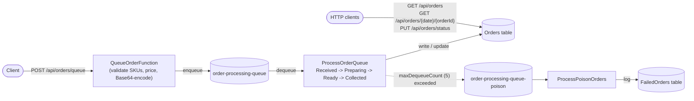

# CoffeeNChill

Azure Functions API for CoffeeNChill: menu management, centralized staff documents (Part 1), and queue-based order processing for high-volume break-time ordering (Part 2). Menu and order entities are stored in Azure Table Storage; staff documents use Azure Files in rubric-compliant mode, with an Azurite Blob adapter for local container demonstrations because Azurite does not emulate Azure Files; orders are decoupled from the HTTP request path via an Azure Storage Queue.

## Implemented endpoints

| Method | Route | Purpose |
|---|---|---|
| POST | `/api/menu` | Create a menu item |
| GET | `/api/menu` | List all menu items |
| GET | `/api/menu/category/{category}` | Filter menu items by category |
| PUT | `/api/menu/{category}/{id}` | Update price and/or availability |
| DELETE | `/api/menu/{category}/{id}` | Delete a menu item |
| POST | `/api/documents/upload` | Upload multipart field `file` |
| GET | `/api/documents` | List staff documents and metadata |
| GET | `/api/documents/download/{fileName}` | Download a document |
| DELETE | `/api/documents/{fileName}` | Delete a document (additional endpoint) |
| POST | `/api/orders/queue` | Validate, price and queue a new order onto `order-processing-queue` (Part 2; see [Part 2](#part-2-order-queue-processing) and `docs/CONTRACTS.md`) |
| GET | `/api/orders` | List orders, optionally `?date=yyyy-MM-dd` |
| GET | `/api/orders/{date}/{orderId}` | Get one order, including its full status history |
| PUT | `/api/orders/status` | Forward-only status transition (`{ orderDate, orderId, status }`) |

## Prerequisites

- .NET 10 SDK
- Azure Functions Core Tools v4
- Docker Desktop or Docker Engine
- Postman (or `newman`)
- C#
- Azure Table Storage
- Azure File Storage
- GitHub

## Run locally

1. Start Azurite:

   ```bash
   docker run --name coffeenchill-azurite -d \
     -p 10000:10000 -p 10001:10001 -p 10002:10002 \
     mcr.microsoft.com/azure-storage/azurite
   ```

2. Create the local settings file:

   ```bash
   cd CoffeeNChill.Functions/CoffeeNChill.Functions
   cp local.settings.example.json local.settings.json
   ```

   On Windows PowerShell use:

   ```powershell
   Copy-Item local.settings.example.json local.settings.json
   ```

3. Start the Functions host:

   ```bash
   func start --port 7071
   ```

`UseDevelopmentStorage=true` connects the host process to Azurite on localhost. `local.settings.json` is intentionally ignored by Git. `OrderStatusStepDelaySeconds` (default `3`, set in `local.settings.example.json`) controls how long `ProcessOrderQueue` waits between each status transition - lower it for a faster local demo, but see [the visibility-timeout trade-off](#queue-processing-lifecycle) below before setting it above a few seconds.

## Standalone Docker execution

No Docker Compose is required.

1. Create a network and run the tagged Azurite container:

   ```bash
   docker network create coffeenchill-network
   docker pull mcr.microsoft.com/azure-storage/azurite
   docker tag mcr.microsoft.com/azure-storage/azurite coffeenchill-azurite:v1.0
   docker run --name azurite --network coffeenchill-network -d \
     -p 10000:10000 -p 10001:10001 -p 10002:10002 \
     coffeenchill-azurite:v1.0
   ```

2. Build the Functions image from the Functions project directory:

   ```bash
   cd CoffeeNChill.Functions/CoffeeNChill.Functions
   docker build -t <dockerhub_username>/coffeenchill-functions:v1.0 .
   ```

3. Run the Functions container on the same network:

   ```bash
   docker run --name coffeenchill-functions --network coffeenchill-network \
     -p 7071:80 \
     -e FUNCTIONS_WORKER_RUNTIME=dotnet-isolated \
     -e DocumentStorageMode=Blob \
     -e 'AzureWebJobsStorage=DefaultEndpointsProtocol=http;AccountName=devstoreaccount1;AccountKey=Eby8vdM02xNOcqFlqUwJPLlmEtlCDXJ1OUzFT50uSRZ6IFsuFq2UVErCz4I6tq/K1SZFPTOtr/KBHBeksoGMGw==;BlobEndpoint=http://azurite:10000/devstoreaccount1;QueueEndpoint=http://azurite:10001/devstoreaccount1;TableEndpoint=http://azurite:10002/devstoreaccount1;' \
     <dockerhub_username>/coffeenchill-functions:v1.0
   ```

Inside a container, `UseDevelopmentStorage=true` would point to that same container rather than the separate Azurite container. The explicit connection string above therefore uses the Azurite container hostname.

## Azure File Share mode

Azurite supports Blob, Queue and Table services, but not Azure Files. To run the document API against the required real Azure File Share, set:

```text
DocumentStorageMode=FileShare
DocumentsConnectionString=<real Azure Storage connection string>
```

The application creates the `staff-docs` share automatically. For the isolated local Docker demonstration, `DocumentStorageMode=Blob` provides the same document API using the Azurite `staff-docs` blob container.

## Postman tests

Import from `/docs`:

- `CoffeeNChill-Part1.postman_collection.json` + `CoffeeNChill-Part1.postman_environment.json` - Part 1 menu/staff-document coverage, run against the **CoffeeNChill Local** environment.
- `CoffeeNChill-Part2.postman_collection.json` + `CoffeeNChill-Part2.postman_environment.json` - the canonical Part 2 collection (superseding the old `CoffeeNChill-Part2-Orders.postman_collection.json`, removed): full Part 1 CRUD plus the complete order queue producer, processing lifecycle and status-transition coverage. See [Running the Part 2 tests](#running-the-part-2-tests) below for why it runs via a script rather than a single in-app "Run collection" click.

The upload request uses `/docs/sample-staff-document.txt`; reselect that file in Postman if its imported path is not resolved automatically.

---

## Part 2: Order queue processing

During break times, hundreds of students can order at once. Part 2 moves order creation off the synchronous HTTP request path: `POST /api/orders/queue` validates the order, prices it from the live menu, and places it on an Azure Storage Queue; a queue-triggered function picks it up, writes it to the `Orders` table, and simulates the barista lifecycle through to collection. A message that can't be processed after repeated retries is moved to a poison queue and logged to a `FailedOrders` table instead of being silently dropped.

### Architecture



Full field-level detail (including every documented trade-off: `OrderId` collision-safety, `SelectedItemSKUs` flattening, the visibility-timeout/redelivery interaction, and the forward-only status rule) lives in **[`docs/CONTRACTS.md`](docs/CONTRACTS.md)**; this section summarizes it.

### Queue message contract

`order-processing-queue`, Base64-encoded, produced by `POST /api/orders/queue`:

```json
{
  "OrderId": "ORD-2026-08801",
  "CustomerName": "Jane Smith",
  "SelectedItemSKUs": ["COF-001", "PAS-104"],
  "TotalPrice": 65.00,
  "OrderTimestamp": "2026-10-12T10:15:00Z",
  "Items": [
    { "Category": "Hot Drinks", "SKU": "COF-001", "Quantity": 1 },
    { "Category": "Pastries", "SKU": "PAS-104", "Quantity": 1 }
  ]
}
```

`OrderId`, `TotalPrice` and `OrderTimestamp` are always server-generated/computed - never trusted from the client. Every SKU is validated against the live `MenuItems` table (unknown or unavailable SKUs are rejected with `400`, naming the bad SKU) before anything is queued.

### Orders / FailedOrders schemas

**`Orders`** (written by `ProcessOrderQueue`): `PartitionKey` = order's UTC date (`yyyy-MM-dd`), `RowKey` = `OrderId`, plus `CustomerName`, `SelectedItemSKUsJson`, `TotalPrice`, `OrderTimestamp`, `Status`, `StatusUpdatedAt`, `StatusHistoryJson` (JSON-serialized, since Table Storage has no array type - the HTTP endpoints reshape these back into real arrays).

**`FailedOrders`** (written by `ProcessPoisonOrders`): `PartitionKey` = the date the failure was logged, `RowKey` = the queue message's id, plus `RawBody`, `Reason`, `LoggedAt`.

### Queue processing lifecycle

`ProcessOrderQueue` logs the message id and dequeue count, writes `Received`, then advances `Preparing -> Ready -> Collected` with a configurable delay between steps (`OrderStatusStepDelaySeconds`, default `3`) so the lifecycle is watchable live. It's idempotent: a redelivered message (same `OrderId` already in the table) resumes from whatever status that row is already at instead of throwing. `host.json` fixes `visibilityTimeout` at 10 seconds; at the default step delay the three remaining transitions take ~9s of delay alone, which is tight rather than comfortable. If a redelivery does happen, it's made safe rather than corrupting by two things working together: the idempotent create, and every status write going through ETag optimistic concurrency, so a losing concurrent write becomes a logged no-op instead of a crash. Full reasoning in `docs/CONTRACTS.md`.

A malformed message, or one missing required fields, is logged at `Error` with the raw body and rethrown, letting the runtime's own retry mechanism move it to `order-processing-queue-poison` after `maxDequeueCount` (5) attempts; `ProcessPoisonOrders` logs the full failure detail and records it in `FailedOrders`.

### Docker Compose (`v2.0`)

A single command starts the whole stack - Azurite and the Functions host, both pulled from Docker Hub:

```bash
docker compose up -d
```

This pulls `ghee9ine/coffeenchill-azurite:v2.0` and `ghee9ine/coffeenchill-functions:v2.0` (overridable via `DOCKERHUB_USERNAME`/`IMAGE_TAG` - copy `.env.example` to `.env` to change them), starts Azurite on a named volume (`azurite-data`, so table/queue/blob data survives a restart) on the custom `coffeenchill-net` bridge network, waits for Azurite's healthcheck before starting the Functions container, and exposes the same ports as the manual setup above (`7071` for the API, `10000`-`10002` for Azurite).

Verified from a clean slate (`docker compose down -v`, `docker image rm` both `v2.0` images, then `docker compose up -d`): both images pull from Docker Hub rather than building locally, both containers report healthy/running, `docker logs coffeenchill-functions` lists all 13 HTTP routes and both queue triggers (`ProcessOrderQueue`, `ProcessPoisonOrders`), and a queued order runs the full `Received -> Preparing -> Ready -> Collected` lifecycle against the running containers.

Tear down with `docker compose down` (add `-v` to also delete the Azurite data volume).

### Docker Hub publishing

```bash
docker login
docker build -t ghee9ine/coffeenchill-functions:v2.0 CoffeeNChill.Functions/CoffeeNChill.Functions
docker push ghee9ine/coffeenchill-functions:v2.0
docker pull mcr.microsoft.com/azure-storage/azurite
docker tag mcr.microsoft.com/azure-storage/azurite ghee9ine/coffeenchill-azurite:v2.0
docker push ghee9ine/coffeenchill-azurite:v2.0
```

Published images (public):

- Functions `v2.0`: https://hub.docker.com/r/ghee9ine/coffeenchill-functions
- Azurite `v2.0`: https://hub.docker.com/r/ghee9ine/coffeenchill-azurite

The `v1.0` tags above remain published from Part 1; `v2.0` is what `docker-compose.yml` pulls by default.

### Running the Part 2 tests

```bash
docker compose up -d        # or: func start --port 7071
cd docs
./run-tests.sh              # or .\run-tests.ps1 on Windows PowerShell
```

This runs `CoffeeNChill-Part2.postman_collection.json` via `newman` in two passes with a real sleep in between, rather than one single `newman run`: the order lifecycle needs ~9-10 real seconds to reach `Collected`, and a delay inside the collection's own pre-request script (tried first) measurably starved the containers of CPU on a dev machine, leaving the order stuck on `Received` instead of actually completing. The status-transition tests use a short, self-contained retry-on-`404` poll loop instead of a second guessed delay, for the same reason plus one more: a fixed delay there was flaky in *both* directions (too short and the order's row doesn't exist yet; too long and the background lifecycle may have already advanced the order past the status being tested). Both scripts exit non-zero if any assertion fails.

**Poison-queue demo** (optional, documented rather than automated - Postman has no way to place a raw message on a queue): with the compose stack running,

```bash
az storage message put --queue-name order-processing-queue \
  --content "$(echo -n 'not valid json at all' | base64)" \
  --connection-string "DefaultEndpointsProtocol=http;AccountName=devstoreaccount1;AccountKey=Eby8vdM02xNOcqFlqUwJPLlmEtlCDXJ1OUzFT50uSRZ6IFsuFq2UVErCz4I6tq/K1SZFPTOtr/KBHBeksoGMGw==;BlobEndpoint=http://127.0.0.1:10000/devstoreaccount1;QueueEndpoint=http://127.0.0.1:10001/devstoreaccount1;TableEndpoint=http://127.0.0.1:10002/devstoreaccount1;"
```

then watch `docker logs coffeenchill-functions` show 5 retries before the message moves to `order-processing-queue-poison` and a row appears in `FailedOrders` - or point Azure Storage Explorer at the same connection string to see both queues and the table directly.

---

## Changelog

### v2.0 (Part 2)

- **Part 1 compliance fixes** (`fix/part1-compliance`): corrected routes, a missing endpoint, the document-storage mode switch, response serialization, and the Postman collection.
- **Producer brief alignment** (`fix/producer-brief-alignment`): renamed the queue to `order-processing-queue`; `OrderMessage` now carries the brief's five named fields (`OrderId`, `CustomerName`, `SelectedItemSKUs`, `TotalPrice`, `OrderTimestamp`); every SKU is validated against live `MenuItems` and `TotalPrice` is computed server-side, never trusted from the client; `OrderId` is now `ORD-{yyyy}-{5-digit}`, not a raw GUID.
- **Queue-triggered order processing** (`feature/order-processing-function`): `ProcessOrderQueue` writes `Received` and simulates the full barista lifecycle to `Collected`; idempotent on redelivery; `ProcessPoisonOrders` + `FailedOrders` for messages that exhaust retries; `GET /api/orders`, `GET /api/orders/{date}/{orderId}`, `PUT /api/orders/status` added.
- **Docker Compose + Docker Hub `v2.0`** (`feature/docker-compose`): `docker-compose.yml` pulling both services from Docker Hub by default, custom bridge network, named Azurite volume, healthcheck-gated startup.
- **Postman + documentation** (`docs/part2-deliverables`): canonical `CoffeeNChill-Part2` collection + environment (supersedes `CoffeeNChill-Part2-Orders`), `run-tests.sh`/`run-tests.ps1`, this README section, `docs/VIDEO_SCRIPT_PART2.md`.

### v1.0 (Part 1)

Initial project structure, menu CRUD, staff-document upload/list/download/delete, standalone Docker + Docker Hub publishing.

## Group contributions

`main` has 10 commits from `KgaoT` and 40 from Sean Chihwendu, across six merged PRs: Part 1 compliance fixes, the order queue producer, producer brief alignment, queue-triggered order processing, Docker Compose + Docker Hub `v2.0`, and the Part 2 Postman/documentation deliverables (PRs #1-#6). **TODO**: Tetelo and Palee each need at least 5 meaningful commits on their own branches before submission; update their rows and the commit count above once those land.

| Group member | Student number | Contribution |
|---|---|---|
| Kgaogelo Tladi | ST10403879 | Initial project structure and staff-document foundation |
| Sean Chihwendu | ST10455091 | Part 1 compliance audit and fixes (routes, missing endpoint, document-storage mode, serialization, Postman); all of Part 2 - order queue producer aligned to the brief's contract (SKU validation, server-computed pricing, Base64 encoding), queue-triggered order processing with the full status lifecycle and poison-queue handling, Docker Compose + Docker Hub `v2.0`, and the Part 2 Postman collection/test scripts/documentation |
| TODO (Tetelo) | TODO | TODO |
| TODO (Palee) | TODO | TODO |

## Demonstration video

YouTube: **TODO – add the final public or unlisted video URL**

Part 1 video must show both standalone containers, `docker ps`, the complete successful Postman run, and the stored menu/document data. Part 2 video (script: `docs/VIDEO_SCRIPT_PART2.md`) must additionally show `docker compose up -d` pulling `v2.0` from Docker Hub, the `newman` run, a message landing in the queue, live `Orders` table status changes, and the poison-queue demo.

## Important Azurite ports

| Port | Service |
|---|---|
| 10000 | Blob |
| 10001 | Queue |
| 10002 | Table |
